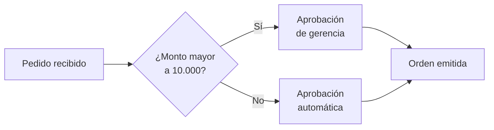

# Informe trimestral

MD Desktop edita **Markdown** de forma visual: tablas, diagramas, código y enlaces, sin perder el texto plano.

## Ventas por región

| Región    | T1      | T2      | Variación |
|-----------|--------:|--------:|----------:|
| Norte     | 12.400  | 14.950  | +20,6 %   |
| Centro    | 18.200  | 17.640  | −3,1 %    |
| Sur       |  9.800  | 11.320  | +15,5 %   |
| **Total** | **40.400** | **43.910** | **+8,7 %** |

## Proceso de aprobación



## Tareas

- [x] Cerrar el balance
- [x] Revisar desvíos
- [ ] Presentar al directorio

> Exportá este documento a PDF, Word (.docx), ODT o HTML desde **Archivo → Exportar**.

```ts
const total = regiones.reduce((s, r) => s + r.t2, 0);
```
