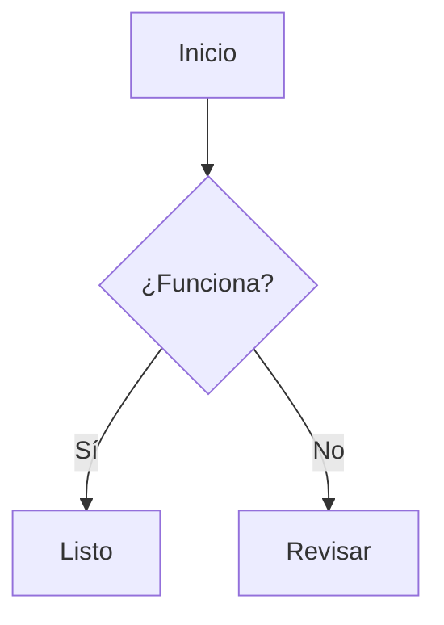

# Documento de exportación

Párrafo con **negrita**, *cursiva*, ~~tachado~~, `código en línea` y un [enlace](https://example.com).

## Listas

- Uno
- Dos
  - Anidado

1. Primero
2. Segundo

- [x] Tarea hecha
- [ ] Tarea pendiente

## Tabla

| Columna A | Columna B | Columna C |
|-----------|-----------|-----------|
| 1         | dos       | tres      |
| 4         | cinco     | seis      |

## Código

```ts
function saludar(nombre: string): string {
  return `Hola, ${nombre}!`;
}
```

## Imagen


## Gráfico



> Una cita para cerrar.
